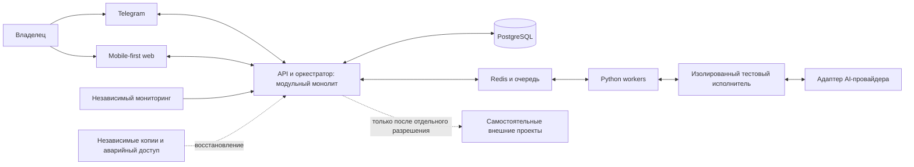

# Контекст системы

Статус: утверждённые границы из B/P/U; схема потоков и распределение ответственности — DERIVED. [Источники и R](../requirements/REQUIREMENTS_REGISTER.md), [решения](../decisions/DECISION_REGISTER.md).

Схема логическая: это не утверждение сетевой топологии, прямого доступа исполнителя к Redis или конкретных внутренних модулей. Исполнитель отделён от доверенного управляющего контура; workers не обязаны находиться в его среде. Детальные контракты и размещение OPEN (D19–D22, D26).

| Участник / компонент | Ответственность | Граница и связи |
| --- | --- | --- |
| Владелец | Задачи естественным языком, просмотр фактов, согласования и отзыв | R02,R03,R12,R13,R28; способ идентификации D23 OPEN |
| Telegram и web | Каналы одного состояния задач и согласований | R03,R10,R44; UI не заменяет проверку полномочий |
| API/оркестратор | Жизненный цикл, зависимости, проверки допуска, лимиты | R04–R14,R35–R40; точные модули D19 OPEN |
| PostgreSQL | Основная БД; сохранение задач, результатов и журналов | R09,R11,R22,R31; схема и политика хранения OPEN |
| Redis/очередь, Python workers | Передача и исполнение заданий | R29; доставка, отмена и восстановление D20 OPEN |
| Исполнитель и AI-адаптер | Ограниченная задача, выдача результата и доказательств | R16,R17,R24; результат недоверен до R06,R19 |
| Мониторинг, аварийный доступ, копии | Обнаружение отказа и восстановление вне зависимости от приложения | R28,R30–R32,R41; защита от компрометации D26 OPEN |
| GitHub/CI | Ветки, коммиты, проверки и PR; происхождение релиза | R23,R25–R27,R33; контроль происхождения см. ниже |
| Внешние проекты | Собственные данные и инфраструктура | R45–R47; в MVP подключений нет |

Предлагаемый поток (DERIVED): задача → запись и версия → проверка зависимостей/прав/расходов → при необходимости точное согласование → резерв → очередь → изолированное исполнение → фактический результат → независимая проверка значимых изменений → журнал и отчёт. Неизвестный исход переводится на сверку; подтверждение и лимиты проверяются перед действием, а не только при вводе задачи. Конкретная машина состояний ещё OPEN.

Контроль происхождения сборок и выпускаемых артефактов утверждён U2/Безопасность; R51 и D30 связывают этот контроль с R23,R33 (см. реестры). Формат аттестаций и подписи не выбран.

Управляющий контур — отдельный постоянно доступный VPS (R01); облачные исполнители — по запросу (R16). Docker Compose утверждён как исходный способ развёртывания, но не выбран как достаточный механизм безопасной изоляции исполнителей.

Capital Lab, CRM «Ваниль и Сахар» и CRM автосервиса не становятся модулями монолита. Автосервис остаётся на паузе. Подключения, реальные данные, платные вызовы и production не разрешены заданием 0B.

## Дополнение Stage 0C-1: подтверждённая историческая сводка

Источник — [SRC-0C1](../history/stage-0c-1/SOURCE_PACKAGE.md); [матрица H/R/D](../history/stage-0c-1/RECONCILIATION_MATRIX.md) описывает изменения полноты контекста. Восстановленные ограничения OWNER_APPROVED_SUMMARY:

- H-A03/H-A04: управляющий контур работает независимо от домашнего ПК; постоянный VPS и внешние coding agents по запросу.
- H-A07: разрешения обеспечивает независимый детерминированный policy layer; AI judgment не обходит его. Это логическая граница, не выбор отдельного сервиса.
- H-A08/H-A09: каждому действию соответствуют атрибутируемые долговечные доказательства, записи и исход; связаны requirements, approved decisions, Git revisions, tests, approvals и results.
- H-A10: критические monitoring, emergency controls, audit history и backups не зависят от доступности AI-провайдеров.
- H-B05/H-B06/H-B10/H-B13: структурированные задачи и знания с provenance/approval status; единое состояние включает incidents/history; краткие отчёты ведут к фактическим доказательствам.

Схема выше остаётся логической. Размещение policy layer, хранилище знаний, контракты данных и реализация новых каналов ввода OPEN, не добавлены на схему как развёрнутые компоненты. [Статус VPS](INFRASTRUCTURE_STATUS.md): уже куплен по сообщению владельца; доступ к консоли временно нарушен; настройка и deployment Stage 0C не разрешены, readiness не проверена.
