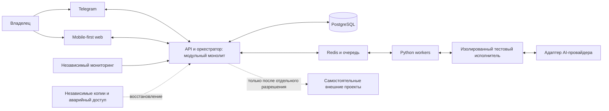

# Контекст системы

Статус: утверждённые границы из B/P/U; схема потоков и распределение ответственности — DERIVED. [Источники и R](../requirements/REQUIREMENTS_REGISTER.md), [решения](../decisions/DECISION_REGISTER.md).

Схема логическая: это не утверждение сетевой топологии, прямого доступа исполнителя к Redis или конкретных внутренних модулей. Исполнитель отделён от доверенного управляющего контура; workers не обязаны находиться в его среде. Детальные контракты и размещение OPEN (D19–D22, D26).

| Участник / компонент | Ответственность | Граница и связи |
| --- | --- | --- |
| Владелец | Задачи естественным языком, просмотр фактов, согласования и отзыв | R02,R03,R12,R13,R28; способ идентификации D23 OPEN |
| Telegram и web | Каналы одного состояния задач и согласований | R03,R10,R44; UI не заменяет проверку полномочий |
| API/оркестратор | Жизненный цикл, зависимости, проверки допуска, лимиты | R04–R14,R35–R40; точные модули D19 OPEN |
| PostgreSQL | Основная БД; сохранение задач, результатов и журналов | R09,R11,R22,R31; схема и политика хранения OPEN |
| Redis/очередь, Python workers | Передача и исполнение заданий | R29; доставка, отмена и восстановление D20 OPEN |
| Исполнитель и AI-адаптер | Ограниченная задача, выдача результата и доказательств | R16,R17,R24; результат недоверен до R06,R19 |
| Мониторинг, аварийный доступ, копии | Обнаружение отказа и восстановление вне зависимости от приложения | R28,R30–R32,R41; защита от компрометации D26 OPEN |
| GitHub/CI | Ветки, коммиты, проверки и PR; происхождение релиза | R23,R25–R27,R33; контроль происхождения см. ниже |
| Внешние проекты | Собственные данные и инфраструктура | R45–R47; в MVP подключений нет |

Предлагаемый поток (DERIVED): задача → запись и версия → проверка зависимостей/прав/расходов → при необходимости точное согласование → резерв → очередь → изолированное исполнение → фактический результат → независимая проверка значимых изменений → журнал и отчёт. Неизвестный исход переводится на сверку; подтверждение и лимиты проверяются перед действием, а не только при вводе задачи. Конкретная машина состояний ещё OPEN.

Контроль происхождения сборок и выпускаемых артефактов утверждён U2/Безопасность; R51 и D30 связывают этот контроль с R23,R33 (см. реестры). Формат аттестаций и подписи не выбран.

Управляющий контур — отдельный постоянно доступный VPS (R01); облачные исполнители — по запросу (R16). Docker Compose утверждён как исходный способ развёртывания, но не выбран как достаточный механизм безопасной изоляции исполнителей.

Capital Lab, CRM «Ваниль и Сахар» и CRM автосервиса не становятся модулями монолита. Автосервис остаётся на паузе. Подключения, реальные данные, платные вызовы и production не разрешены заданием 0B.

## Дополнение Stage 0C-1: подтверждённая историческая сводка

Источник — [SRC-0C1](../history/stage-0c-1/SOURCE_PACKAGE.md); [матрица H/R/D](../history/stage-0c-1/RECONCILIATION_MATRIX.md) описывает изменения полноты контекста. Восстановленные ограничения OWNER_APPROVED_SUMMARY:

- H-A03/H-A04: управляющий контур работает независимо от домашнего ПК; постоянный VPS и внешние coding agents по запросу.
- H-A07: разрешения обеспечивает независимый детерминированный policy layer; AI judgment не обходит его. Это логическая граница, не выбор отдельного сервиса.
- H-A08/H-A09: каждому действию соответствуют атрибутируемые долговечные доказательства, записи и исход; связаны requirements, approved decisions, Git revisions, tests, approvals и results.
- H-A10: критические monitoring, emergency controls, audit history и backups не зависят от доступности AI-провайдеров.
- H-B05/H-B06/H-B10/H-B13: структурированные задачи и знания с provenance/approval status; единое состояние включает incidents/history; краткие отчёты ведут к фактическим доказательствам.

Схема выше остаётся логической. Размещение policy layer, хранилище знаний, контракты данных и реализация новых каналов ввода OPEN, не добавлены на схему как развёрнутые компоненты. [Статус VPS](INFRASTRUCTURE_STATUS.md): уже куплен по сообщению владельца; доступ к консоли временно нарушен; настройка и deployment Stage 0C не разрешены, readiness не проверена.

## Дополнение Stage 0C-2: логические обязанности

Источник — [SRC-0C2](../history/stage-0c-2/SOURCE_PACKAGE.md), OWNER_APPROVED_SUMMARY; [impact](../history/stage-0c-2/IMPACT_REPORT.md) и распределение по прежним компонентам — DERIVED.

- H-C01–H-C04/H-C07/H-C13: один явно выделенный primary priority при bounded concurrency, AI PM для roadmap/milestones/risks/acceptance, living versioned knowledge, readiness по actual prerequisites/approvals/evidence, dependency graph с блокировкой invalidated/unverified predecessors и controlled impact analysis.
- H-C08–H-C10: только approved incident policy допускает permitted priority changes при verified critical incidents; risk-based exact consent показывается interactive cards с action/scope/risk/expected effects/relevant versions/expiry. Card не заменяет H-A07 policy enforcement.
- H-C11/H-D01/H-D02: гибридный execution сохраняется; выбор модели/провайдера учитывает quality/capability/safety/cost/availability в подтверждённых permissions/limits. Resume/stop/event/artifact capabilities не считаются одинаковыми.
- H-C06/H-D08/H-D13: durable checkpoints/history/artifacts/status; перед retry/resume сверка actual agent/Git/external state; handoff передаёт task/versions/dependencies/permissions/tests/evidence/questions/next safe actions, не новые права.

Это не новые развёрнутые сервисы или изменение модульного монолита. Primary project, incident policy, схемы graph/knowledge/handoff и adapter mechanisms — OPEN. Один тестовый исполнитель MVP и внешняя самостоятельность Capital Lab/CRM сохраняются; автосервис PAUSED. Доступа к купленному VPS, тестов консоли, deployments и paid provider calls в Stage 0C-2 нет.

## Дополнение Stage 0C-3: health, policy и failure boundaries

Источник [SRC-0C3](../history/stage-0c-3/SOURCE_PACKAGE.md) — OWNER_APPROVED_SUMMARY; [impact](../history/stage-0c-3/SECURITY_AND_RECOVERY_IMPACT.md) и распределение по компонентам — DERIVED, не новые deployment decisions.

- H-E01–H-E03/H-E07/H-E10: technical/business health различаются; adaptive polling/dedup/change detection, severity/urgency/confidence/impact и local quiet hours; verified evidence отдельно от forecasts/RCA hypotheses.
- H-E12/H-E13: mobile-first health различает healthy/degraded/unknown/stale/paused/failed; incident card связан с exact incident/version/evidence/actions/approval/outcome. Семантика transitions/thresholds OPEN.
- H-E09/H-F03/H-F05: watchdog/emergency alert вне primary failure domain; console emergency path; Telegram/web/monitoring/history/emergency продолжаются без AI. Второй постоянный VPS по умолчанию не требуется.
- H-F04/H-F06: actual credentials/permissions контролирует независимая deterministic policy, unknown action blocked; внешние сообщения/файлы/sites/tools/repo — data с provenance, не authority для permission bypass.
- H-F11/H-F12/H-F15: unique operations/durable journals/concurrency/versioning/leases/heartbeats, dependent pause при uncertain effect, reconnection reconciliation jobs/costs/permissions. Provider guarantees ограничивают stop/quarantine; immediate external kill не обещается.
- H-F02/H-F10/H-F16: applicable localization/legal review, env/data isolation/synthetic default и exact CI/dependency/artifact provenance; никакие реальные customer data и production secrets сейчас не используются.

[Infrastructure status](INFRASTRUCTURE_STATUS.md) сохранён без обновления фактов: VPS уже куплен по сообщению владельца, console impairment reported, readiness неизвестна. H-F14 требует preflight перед future server deployment/production, но **запрещает preflight и VPS access в Stage 0C-3**. Схема выше остаётся логической; isolation/policy/watchdog placement и backup topology не выбраны.

## Дополнение Stage 0C-4: future analytics и план инфраструктуры

Источник [SRC-0C4](../history/stage-0c-4/SOURCE_PACKAGE.md), OWNER_APPROVED_SUMMARY; [impact](../history/stage-0c-4/ANALYTICS_AND_INFRASTRUCTURE_IMPACT.md) и группировка DERIVED.

- H-G01–H-G03/H-G05/H-G06/H-G08: fact/interpretation/recommendation разделены, versioned owner-approved KPI definitions и authoritative sources; causal claims/scenarios/backtesting/evaluation требуют evidence, без invented formulas/accuracy.
- H-G09–H-G11: reconciled accounting/cohort/identity/marketing analytics с lawful/privacy/matching uncertainty и disclosure missing sources. [Offline Ytimes/storefront CRM double counting](../history/stage-0c-4/SOURCE_PACKAGE.md#confectionery-double-counting) запрещён; matching keys/правила не заданы.
- H-G04/H-G07/H-G12/H-G13: shared mobile-first web/Telegram, 08:00/14:00/21:00 local под delivery policies, scoped evidence drill-down; ranked recommendations — proposed tasks, не изменение owner priorities или consent.
- H-H01/H-H04/H-H13: hybrid persistent control VPS + isolated on-demand agents без home-PC runtime, modular-monolith stack/versioned interfaces, separate CRM/Radmin; convenience не причина новых infra services.
- H-H02/H-H03/H-H05/H-H06: approximate sizing/Ubuntu LTS/pinned Compose/security/controlled secrets mechanism/provisional recovery — плановые нормы, не deployed components или verified server facts.

Диаграмма выше остаётся логической: BI/warehouse/new secrets service/второй VPS не добавлены как выбранные сервисы. Полноценная analytics future scope за MVP, Capital Lab/CRM кондитерской standalone potential pilots, автосервис PAUSED. [Infrastructure status](INFRASTRUCTURE_STATUS.md) отделяет planning от owner-reported purchase/console impairment; current config/security/billing/readiness неизвестны. Ни preflight, ни actual integrations/data сейчас не разрешены.

## Stage 0C-5: authoritative state, owner identity и evidence

[Source](../history/stage-0c-5/SOURCE_PACKAGE.md), [matrix](../history/stage-0c-5/RECONCILIATION_MATRIX.md); source-backed нормы отделены от DERIVED группировки:

- H-I04/H-I05: structured monorepo с logical orchestrator/API/Telegram/web/infra/migrations/tests, approved modular-monolith stack; не отдельные microservices.
- H-I06/H-I11: PostgreSQL authoritative durable runtime tasks/runs/approvals/dependencies/audit/journals/evidence; Redis только work transport, Git для approved requirements/decisions/contracts/docs. IDs/leases/crash reconciliation, no exactly-once external promise.
- H-I07/H-I19: scoped provider start/status/events/artifacts/results/stop/reconciliation/capabilities, versioned OpenAPI/queue contracts и compatibility; unsupported provider semantics не выдумываются.
- H-I13/H-I14: redacted structured logs/metrics/trace IDs всей цепочки и mobile visibility; one-owner MVP, secure web MFA, verified Telegram binding, critical step-up, exact approval params/version/expiry.
- H-I08/H-I15/H-I17: scoped temp credentials/evidence-before-cleanup, rotation/revoke/proxy where necessary, multi-level kill switches с protected monitoring/backups/audit; no real brokerage trading credentials у coding agents.

Конкретные module/data schemas, protocols/providers/products и versions остаются OPEN у [stage gates](../history/stage-0c-5/CONFLICTS_AND_UNCERTAINTIES.md). Схема выше логическая, не реализация. [Master impact](../history/stage-0c-5/MASTER_PLAN_IMPACT.md) показывает possible future offline slice без VPS, но сейчас никакой coding/service/provider/server action не разрешён.
