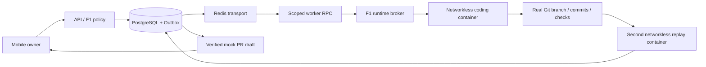

# F2: bounded synthetic coding agent

## Authority and dependency

Source: owner's **F2: AUTONOMOUS CODING AGENT** assignment in this session.
Implementation branch: `feat/f2-autonomous-coding-agent`, based on PR #12
`feat/f1-infrastructure-hardening` at `3d5dcd9c8f8934f119547b24813139510af52334`.
PR #8–#12 remain dependencies, not merged main functionality. No main changes,
VPS access, paid API calls, customer data or remote business repositories.
Earlier H/R/D entries and their historical status are unchanged.

## Executable scope

The owner creates one bounded task through the authenticated mobile panel or
`POST /api/coding/tasks`. The only admitted repository is `f2-synthetic-sum`,
objective `sum_positive_v1`, provider `mock`. Its normative Git base is generated
from the three fixed files in `coding/spec.py`; only `calculator.py` may change.
The API rejects extra fields, different repositories/providers/revisions and
out-of-range limits. This is an intentionally narrow, real edit/test/repair
exercise, **not a general-purpose AI developer**. The deterministic mock emits
an incorrect implementation first and a correct implementation after the failed
checks. It does not perform AI reasoning.

PostgreSQL remains authoritative. Task payload/hash, pinned source, admission,
role checks, epoch, lease, fencing, audit integrity and spending reservation use
the existing F1 Store and broker; there is no second grant authority. Only the
owner may create coding tasks. No per-file, per-command or per-test approvals
are introduced (R-F1-AUTO-01). Runtime ledger remains stop/evidence coordination,
not a source of task or approval truth.

The coding evidence substate is `queued → coding → verification → complete`,
or `failed`; F1 task states remain authoritative. Completion is accepted only
through F1 `finish`, rechecking current lease/fence/epoch/source/audit. A prepared
draft is returned by the API only for a `SUCCEEDED` task. Cancellation cannot be
undone by retry or resume. Unknown usage retains its reservation even after a
container is confirmed absent; absence is not billing evidence.

## Execution and evidence

Each execution has a fresh tmpfs workspace and branch `f2/task-<UUID>-<fence>`.
Dulwich creates an actual local Git object store, baseline and successive commits;
no clone, remotes, hooks, host paths or archive extraction are accepted. The
baseline tests and README cannot change. Edit proposals are typed path/content
maps, not shell commands. The fixture's allowed Python AST is deliberately
restricted to the known safe exercise implementations, with a size/secret guard.
This policy is not a claim of safe arbitrary Python execution.

Each iteration applies an edit, commits it and launches the trusted acceptance
runner. Four tests cover empty, positive, mixed and nonpositive inputs. The first
mock implementation fails two tests; the second passes four. Provider usage,
iteration/test results and Git history are preserved. Failed checks trigger a
bounded repair; exhausted attempts, time, tokens or units stop execution.

The independent verifier imports neither agent nor provider implementation. It
checks raw Git object IDs/checksums and reachability, exact baseline, linear pinned
history, flat regular file modes, unchanged acceptance files, allowed AST, branch,
usage and reported checks. A **second container** reconstructs the Git history and
actually reruns the trusted tests for every commit. The broker compares this proof
with its deterministic report before completing. Both stages share the original
F1 fence and total deadline. Transition resets observed-stop evidence under the
launcher lock so a watchdog cannot mistake first-stage absence for second-stage
termination. Agent self-reports alone never complete a task.

The verified mock PR contains task link, branch, base/head SHA, diff, test history,
risks and unverified conditions. It has `published: false`, `url: null`. Source
commits are evidence carried as bounded Git objects, not branches pushed to this
project or a remote fixture repository. No automatic merge exists.

## Isolation and bounds

API/worker have no Docker socket; only the existing trusted broker/watchdog can
launch/stop through F1. Coding containers have no PG, Redis, owner, broker or
provider credentials, network, host mounts, Docker socket, SSH or administrative
capabilities. They run nonroot, read-only root, dropped capabilities,
no-new-privileges and a private noexec/nosuid/nodev tmpfs. Trusted Python can read
source from this tmpfs; noexec is not presented as a Python security boundary.
Immutable coding image revision must match the exact control-plane commit.

Default sandbox: 0.5 CPU, 128 MiB RAM, 32 processes, 16 MiB tmpfs, bounded file,
stdout/stderr and Docker logs inherited from F1. One execution at a time, including
verification. Resource settings use the validated F1 runtime limits, including
the host free-disk guard. Defaults: two iterations, two synthetic units, 2048
synthetic byte-count tokens, 15 seconds total; API maxima: 3/3/4096/20 seconds.
These counters are **not real billed tokens or verified RUB prices**. They reserve
and settle synthetic kopeck units through the existing F1 budget ledger. No paid
operation is enabled by this reservation.

Owner cancellation, deadline, lost authority, watchdog loss or broker failure
prevents acceptance. Runtime stop must be confirmed; an unconfirmed stop remains
uncertain and blocks further starts. F1 recovery reconciles instead of blindly
relaunching. The watchdog is independent of the worker but shares host/runtime;
Docker and the launcher remain trusted. Rootless-required remains the deployment
default; explicit cloud-rootful-test does not prove rootless host security.

## Provider and PR adapters

`CodingProvider` is provider-neutral, typed and noninteractive. `MockProvider` is
the only provider admitted by task policy. `ResponsesProvider` implements official
OpenAI `POST /v1/responses`, structured JSON output, `store:false`, bounded input,
output and timeout, with no automatic retry on uncertain outcomes. Interface was
checked against the official SDK source:
<https://github.com/openai/openai-python/blob/main/src/openai/resources/responses/responses.py>.
It is dormant, default-denied and tested with HTTP MockTransport only. There is
no invented Codex Cloud API and no claim that Codex or a real model was tested.
No provider prompt, authorization header or response body is logged.

`GitHubPublisher` is a dormant official REST adapter with exact remote ref preflight,
separate credential, draft-only creation and an intent journal that prevents blind
retries after a timeout. HTTP tests use synthetic journals. **Real activation is
blocked** until a durable PG-backed journal, independently allowlisted synthetic
remote, authorized branch publication, scoped credential broker, cost/rights/data
checks and external-state reconciliation are implemented and separately authorized.
An adapter constructor flag is not a replacement for F1 owner authorization.
No GitHub credential enters the coding container.

## Mobile operation

The existing authenticated mobile-first panel starts the predefined exercise with
one action, shows plan, current stage, error/report, individual test outcomes and
the prepared draft, and provides cancellation/emergency stop. Active tasks poll
every three seconds. Technical Git details are expandable. All controls call
server-authorized APIs; hidden UI controls are not the permission boundary.
Mock and real-provider limitations are shown explicitly. Existing synthetic login
and fail-closed OIDC adapter retain F1 limitations; this is not real MFA evidence.

## Reproduction and next real-run gates

Use existing F1 cloud bootstrap, locked dependencies and `scripts/verify_cloud.sh`
from a clean commit. It builds the `coding` Docker target, runs Python/browser and
infrastructure checks, real API/worker container smoke, restart/backup drills and
`scripts/coding_smoke.py`. The latter checks the full Outbox/Redis/worker/broker/
two-container flow and writes `.runtime/coding-smoke.json` without secrets.

Before any real coding-provider run: separate owner grant, verified compatible
noninteractive provider, scoped egress/secret proxy, known pricing and maximum
reservation, durable provider operation/usage reconciliation, synthetic remote
only, publication gates above and measured runtime isolation. Arbitrary-repository
coding, customer systems, paid AI, VPS deployment and production are not authorized
by completing this exercise. F1 acceptance and host-specific gates remain open.
