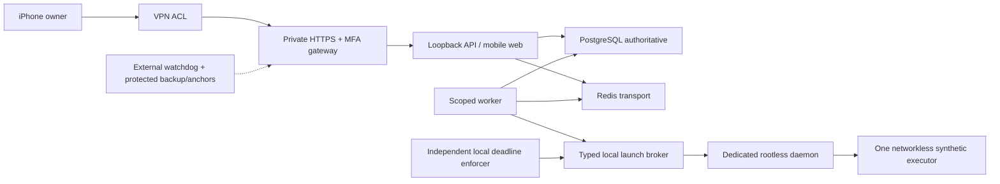

# Изоляция и защищённая архитектура — DERIVED

Diagram describes target, **not running services**. Никаких CRM, реального
Telegram/AI API и клиентских данных. Control-plane Compose — modular-monolith
Python/FastAPI, React/TS, PG, Redis; новые компоненты только для конкретных
требований безопасности/доступа, не ради удобства.

## Разделение прав

| Роль | Допустимо | Запрещено |
| --- | --- | --- |
| Владелец | VPN + MFA + точные task/stop approvals | Раскрывать секреты в чат/Git |
| Infrastructure admin | Отдельный SSH key, аудит, ограниченный sudo по точному этапу | Передавать admin credential агенту |
| Control-plane service | PG app role, Redis, synthetic identities | Host Docker socket, sudo, admin DB, ключ backup |
| Worker | Отдельная PG run-role/узкие run procedures, queue, typed broker | Запись approvals/policy/grants, rootful socket, arbitrary Docker flags, owner keys |
| Launch broker/rootless user | Только dedicated daemon, allowlisted operations | Sudo, host docker group, чужие homes, control-plane secrets |
| Executor | Fixed image, stdin → bounded manifest, /work tmpfs | Сеть, SSH, socket, host mounts, privileged/caps, production credentials |
| Deadline enforcer | Typed status/stop endpoint только known run IDs | Raw socket, start, grant/approval changes, arbitrary host commands |

Обычный Docker с rootful socket у worker **недостаточен** для требования
минимальных полномочий launcher. Mount socket read-only не делает Docker API
read-only. Docker group даёт daemon/host authority. Generic Docker socket proxy
с разрешённым POST /containers/create тоже недостаточен: через HostConfig можно
запросить mounts/privileged, если нет проверки полного тела запроса.

## Рекомендуемый F1 launch boundary

Отдельный системный пользователь без sudo и без rootful docker group; отдельный
rootless daemon с cgroup v2 delegation, отдельным data-root и filesystem quota.
Только малый trusted runtime shim имеет доступ к socket: он реализует проверенный
start path и отдельный typed stop-only endpoint для независимого enforcer.
Enforcer сам socket не получает. Нельзя передавать socket worker/API. Rootless runtime не использует host-root,
но процесс с socket всё равно контролирует ВСЕ контейнеры этого daemon и данные
своего UID. UID не должен владеть PG, backup keys, SSH homes или app credentials.
Stop-only — ограничение endpoint для вызывающего, не свойство Docker credential:
сам shim с socket полностью доверен в пределах dedicated rootless daemon.
Нужны отдельный supervision и admin emergency path; нельзя обещать kill при
неработающем runtime/host.

Общий текущий `f1_app` у API/worker не обеспечивает независимую policy: владеющий
его SQL credential может менять approvals/control. Для future broker gate нужны
раздельные PG роли/процедуры: worker не пишет grants/approvals и не может создавать
owner audit events; авторизация владельца пишет их через отдельный trusted path.
Broker читает authoritative grants своим ограниченным credential, не доверяет
заявлению worker. Audit actor выводится из доверенного пути/роли, не свободного
поля сообщения. Эта миграция прав/adapter — часть G2, ещё не реализована.

Broker не принимает Docker JSON/CLI, image URLs или произвольные пути.
Запрос: task UUID/attempt/fence/epoch/source SHA/payload hash/approved image digest/
lease expiry/wall deadline. Независимая read-only policy-проверка PG + audit chain
под согласованным admission протоколом; запрос не сам себе разрешение. Перед start
перепроверить grant, текущую lease, approvals и immutable image; exact task_created
revision из PR #10 обязательна. Зафиксировать intent и собственный durable run
ledger вне Redis. Недоступна PG или расходятся версии → no start.

Фиксированный профиль — [launcher-policy.json](../../infra/vps/templates/launcher-policy.json):
1 run, 0.5 CPU/128 MiB/32 PIDs/16 MiB tmpfs, no network/rootfs write/caps/host mounts,
non-root 65532, output 64 KiB, bounded attempts и wall clock. Значения lease=15 s,
wall=30 s наследуют профиль F1; это не общие гарантии production. CPU/RAM/PIDs должны
быть фактически enforced в rootless cgroup, не просто приняты CLI.

Start/stop операции fence/expiry-bound; stop idempotent только для точного known
run ID/daemon. Нельзя выбирать контейнер по одному свободному label из сообщения.
При cancel → grace stop → bounded kill → inspect подтверждает остановку → evidence
→ cleanup. Если нельзя подтвердить stop: удержать reservation, halt admission,
инцидент, независимый enforcer/admin emergency; не запускать замену.

Enforcer независимо от worker хранит зарегистрированный wall deadline и проверяет
lease. Worker crash не продлевает deadline. На reboot сначала **halted boot gate**,
сверка всех собственных run IDs/контейнеров/затрат/отмен, потом owner-approved
resumption. Docker restart=no для executors, lost ledger или неизвестный контейнер
означает quarantine/halt, не удаление evidence и не автоматический retry.

## Дополнительная изоляция

Для фиксированного synthetic JSON→Markdown без внешнего кода rootless Docker с
этими ограничениями — рекомендуемый кандидат после adversarial tests. Это не
доказанная защита от kernel/runtime CVE. Для произвольного AI-generated кода,
недоверенных dependencies или multi-tenant сценария нужен отдельный проверенный
sandbox runtime (например gVisor) либо microVM/отдельный execution host.
Выбор и совместимость не утверждены; nested virtualization на VPS неизвестна.
Нельзя поставить новый runtime или арендовать capacity без разрешения.

## Control-plane template

JSON — YAML-compatible Compose: [compose.control-plane.json](../../infra/vps/compose.control-plane.json).
Только PG/Redis/API, без worker/broker/VPN/auth. PG bootstrap entrypoint начинает
как root внутри контейнера и drops to postgres; это явное исключение template,
не executor privilege. App UID10001 должен читать только свои mounted secret files;
Compose file secrets не обеспечивают самостоятельное шифрование/rotation, uid/mode
bind mounts проверяются реально. UID mapping rootless — отдельная host gate.

API публикуется только 127.0.0.1; PG/Redis без ports, internal network. Frontend
bridge не означает egress deny: нужны host forwarding/DOCKER-USER или эквивалент,
защита IPv6 и фактический external test после разрешения. UFW INPUT сам по себе
не защищает Docker DNAT. Не применять generic firewall flush. По возможности
runtime egress deny; pulls/builds только в отдельном разрешённом maintenance stage.

Image digest + exact source commit + trusted CI/checksums должны совпадать;
локальный tag или OCI label без provenance не доказывают trusted build.
